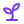

<!-- readme-standard: 2026-11-02 -->
<div align="center">



# 🖼️ The PIR® Gallery

*The fellowship's own photo gallery, kept on GitHub.*

[](https://psychedelicsinrecovery.github.io/gallery/)
[](./LICENSE)


 **You are here:** PIR® › `gallery` · public · `main` is the working branch

</div>

##  TL;DR

1.  **What this is.** Every gathering's albums: the photos live in this repository and the gallery is a single HTML page.
2.  **Who it is for.** Members with photos to add, trusted servants who place them, and anyone looking back at a gathering. Any photo comes down on request.
3.  **Do this first.** [See the gallery](https://psychedelicsinrecovery.github.io/gallery/), or follow the [walkthrough](https://psychedelicsinrecovery.github.io/gallery/walkthrough.html) to add your photos.

> ### Hi — are you a member here looking to upload photos?
>
> You're in the right place, and it's easier than it looks. **[Let us walk you through the process →](https://psychedelicsinrecovery.github.io/gallery/walkthrough.html)**
>
> Two paths: upload to the shared Drive folder and a trusted servant places your photos with care —
> or follow the full walkthrough and see them live in about a minute.

The fellowship's own photo gallery for **Psychedelics In Recovery™ – PIR®** — every gathering's
albums, kept on GitHub. Live at: **https://psychedelicsinrecovery.github.io/gallery/**

A sibling of the [Convention site](https://github.com/psychedelicsinrecovery/convention-astro),
the [AstroLog](https://github.com/psychedelicsinrecovery/changelog-astro), and the
[Convention Hub](https://www.psychedelicsinrecovery.org/convention-hub/). One night sky,
many desks.

> 💡 **How this gallery began:** a WhatsApp request to connect Anne R.'s Pixieset album for the
> Inaugural Convention went wonderfully rogue — a shared Drive folder gathered the fellowship's
> photos from Denver, and the fellowship decided the photos of its recovery deserve a home it owns.
> The Pixieset album and Drive folder that sparked it are woven into the gallery itself.

## Why a gallery of our own

Pixieset is lovely for sharing right now — and this is the version the fellowship owns:

- **No platform.** The photos live in this repository; the gallery is a single HTML page.
- **No cost, no expiry.** GitHub Pages serves it free, fast, worldwide — until the day we outgrow GitHub (and what a day that will be).
- **Many albums, one home.** Not tied to one event: conventions, gatherings, service years — each album is a folder and a card.
- **Anonymity-aware.** Captions use first name + last initial, per the fellowship's tradition.
- **Consent first.** Any photo comes down on request to the gallery's trusted servants.

## The how-to guides (housed here)

This repo is home to the fellowship's friendly how-to guides:

- **[Add your photos to the gallery](https://psychedelicsinrecovery.github.io/gallery/walkthrough.html)** — the member-facing guide: Drive, browser-only, or full terminal path.
- **[Add a picture to the AstroLog](https://psychedelicsinrecovery.github.io/gallery/walkthrough-astrolog.html)** — the assets-shelf guide, moved here so every how-to lives under one roof.

## The photo workflow (for trusted servants and volunteers)

The full, friendly version lives at the [walkthrough page](https://psychedelicsinrecovery.github.io/gallery/walkthrough.html).
The short version:

1. Photos arrive in the shared [Drive folder](https://drive.google.com/drive/folders/1zUL1fHkDIWJLKrtHzfFToceFoFl-PiTu?usp=sharing)
   (or any way they arrive — WhatsApp, email, a USB stick at a convention).
2. Drop them into `assets/albums/<album-id>/`. Name them with a number prefix so the order is
   right: `01-opening-ceremony.jpg`, `02-...`.
3. Rebuild the manifest (no dependencies, just Python):

   ```sh
   python3 tools/build_manifest.py
   ```

   The manifest (`photos.json`) is what the gallery page reads. Captions come from filenames;
   `03-photo-by-maria-r.jpg` gets the credit "Maria R." automatically.
4. Optional per-album details go in `assets/albums/<album-id>/_meta.json`:

   ```json
   {
     "title": "The Inaugural PIR® Convention",
     "when": "October 8-11, 2026",
     "place": "Denver, Colorado",
     "featured": true,
     "astro": "https://psychedelicsinrecovery.github.io/convention-astro/"
   }
   ```

5. Commit and push. GitHub Actions publishes the gallery in about a minute.

## Local preview

```sh
python3 -m http.server 8000
# open http://localhost:8000
```

## The structure

```
index.html         the gallery portal — album spot cards, origin story, masonry, lightbox
walkthrough.html   the member-facing photo walkthrough (linked from the opening blockquote)
walkthrough-astrolog.html  the AstroLog assets-shelf walkthrough (housed here for the suite)
photos.json        the manifest the page reads (generated or hand-edited)
assets/            the photographs, in album folders
tools/             build_manifest.py — scans assets/ and writes photos.json
```

## Trademark

Psychedelics In Recovery™ – PIR®. The marks belong to the fellowship.

---

*Built with care for the fellowship by the PIR® Tech Committee's helpers.*

##  Suggest a change

Noticed something, or want a photo taken down? Tell the gallery's trusted servants: type `/techcom` in [PIR®'s Discord](https://discord.gg/MyprTq8w95). On GitHub, open an [issue](https://github.com/psychedelicsinrecovery/gallery/issues) or a pull request against `main`; a person with the role merges.

<sub>The front door follows the living [README standard](https://github.com/drasticstatic/my-template/blob/main/README-STANDARD.md). Copy it, improve it.</sub>
